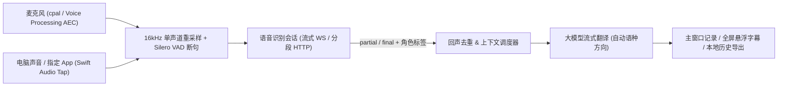

# 听译（TingYi）

[](https://github.com/VmythV/simultaneous-interpretation/releases)
[](https://v2.tauri.app/)
[](https://www.rust-lang.org/)
[](#许可协议)
[](https://github.com/VmythV/simultaneous-interpretation/releases/latest)

**听译（TingYi）** 是一款开箱即用的 macOS 实时语音转文字与同声传译桌面应用。无需安装虚拟声卡，选好「听什么」（麦克风 / 电脑声音 / 双路会议），说话内容即可实时转为文字并流式翻译成目标语言。

---

## 核心特性

- **低延迟流式同传**：基于本地 Silero VAD 精准断句，边说边出实时文字，单句说完约 **1 秒**内流式输出译文；自动检测原文语种并智能切换翻译方向（如 `中 ↔ 英` 双向互译，无需手动切换）。
- **原生系统内录 & 指定 App 采集**：基于 macOS 14.2+ 原生 `Core Audio Process Tap`，**无需安装 BlackHole 等虚拟声卡**；支持采集全局电脑声音，或**仅采集指定 App**（如腾讯会议、Zoom、浏览器），自动过滤其他软件音乐与系统提示音。
- **双路会议模式 & 系统回声消除**：同时采集「麦克风（我）」与「电脑声音（对方）」并按角色分栏标记；内置 macOS `Voice Processing` 硬件级系统回声消除（AEC）+ 文本相似度去重双重保障，外放参会也能有效避免把对方声音误录为自己发言。
- **桌面悬浮字幕**：无边框半透明置顶字幕条，支持在**全屏视频/全屏会议空间**上方显示；支持任意拖拽、边缘缩放、一键**鼠标穿透**，可自由调节字号、透明度、显示句数与显示模式（双语 / 仅译文 / 仅原文）。
- **可插拔识别与大模型翻译**：
  - **语音识别（STT）**：支持阿里云百炼实时流式识别（静音自动停推不计费），以及硅基流动、OpenAI 或任意兼容 `/v1/audio/transcriptions` 的分段识别服务。
  - **AI 翻译（LLM）**：支持阿里云百炼、DeepSeek、OpenAI、Ollama 本地模型及任意兼容 `/v1/chat/completions` 的大模型接口，自动携带上下文保证术语与人称前后一致。
- **菜单栏常驻与全局快捷键**：关闭主窗口后自动驻留系统菜单栏；支持全局快捷键一键启停、开关字幕与切换鼠标穿透。
- **本地历史与多格式导出**：会话记录可选保存在本地，支持随时回看并导出为 **TXT**、**Markdown** 或带时间轴的 **SRT 字幕文件**。
- **隐私优先**：无中间服务端，API Key 仅以 `600` 权限保存在本机配置文件中，音频与文本直连你所配置的服务商（或本机 Ollama）。

---

## 安装与快速开始

### 系统要求

- **操作系统**：macOS **14.2**（Sonoma）及以上版本
- **处理器**：Apple Silicon（M1 / M2 / M3 / M4，安装包为 `aarch64` 架构；Intel Mac 可参考下方说明从源码构建）

### 1. 下载安装

前往 [**Releases**](https://github.com/VmythV/simultaneous-interpretation/releases/latest) 页面下载最新的 `.dmg` 安装包（如 `听译_0.1.0_aarch64.dmg`），双击打开后将 **听译.app** 拖入 `Applications（应用程序）` 文件夹即可。

> **首次打开提示**：应用未进行 Apple 开发者公证。从网络下载后首次打开若提示“无法验证开发者”或“已损坏”，任选以下方式放行即可：
> 1. 在终端运行以下命令移除隔离属性后正常打开：
>    ```bash
>    xattr -cr /Applications/听译.app
>    ```
> 2. 或在「访达 → 应用程序」中**右键点击 `听译.app` → 打开**，也可在「系统设置 → 隐私与安全性」底部点击「仍要打开」。

### 2. 三步完成初始配置

首次启动会自动进入配置向导：

1. **配置语音识别**：选择服务商并粘贴 API Key，点击「测试」验证（内置测试音频，无需麦克风权限）。推荐使用**阿里云百炼**，一个 Key 可同时用于流式语音识别与大模型翻译（注：首次使用需在百炼控制台开通对应实时语音识别模型）。
2. **配置翻译服务**：默认可直接勾选复用语音识别的同一个 Key，点击「测试」确认译文返回正常。
3. **选择默认偏好**：设定默认音源（麦克风 / 电脑声音 / 会议）与目标语言，点击完成后即可点击主界面 **「开始」** 使用。

> 首次采集「麦克风」或「电脑声音」时，macOS 会弹出「麦克风」或「屏幕与系统录音」权限申请，允许后即可正常工作。

---

## 支持的服务商预设

除了内置预设外，语音识别和翻译均支持填写任意兼容 OpenAI 接口规范的自定义服务地址：

| 模块 | 内置预设 | 模式 | 默认模型 | 说明 |
| :--- | :--- | :--- | :--- | :--- |
| **语音识别 (STT)** | 阿里云百炼 *(推荐)* | WebSocket 实时流式 | `qwen-audio-3.1-asr-flash-streaming` | 边说边出字，静音不发包不计费；可选 `fun-asr-realtime`、`paraformer-realtime-v2` |
| | 硅基流动 (SiliconFlow) | 分段转写 | `FunAudioLLM/SenseVoiceSmall` | 兼容 OpenAI 音频接口，单句说完后出字 |
| | OpenAI | 分段转写 | `gpt-4o-mini-transcribe` | 可选 `gpt-4o-transcribe`、`whisper-1` |
| | 自定义 (OpenAI 兼容) | 分段转写 | 自定义 | 兼容 `/v1/audio/transcriptions`（如 Groq、本地 faster-whisper 服务等） |
| **翻译 (LLM)** | 阿里云百炼 *(推荐)* | SSE 流式 | `qwen-flash` | 响应快、成本低，可与语音识别共用同一个 API Key |
| | DeepSeek | SSE 流式 | `deepseek-chat` | 译文自然流畅 |
| | OpenAI | SSE 流式 | `gpt-4o-mini` | 可选 `gpt-4.1-mini`、`gpt-4.1` 等 |
| | Ollama（本地） | SSE 流式 | `qwen2.5:7b` | 本机离线翻译，无需联网 |
| | 自定义 (OpenAI 兼容) | SSE 流式 | 自定义 | 任意兼容 `/v1/chat/completions` 的接口 |

---

## 快捷键与本地数据

### 默认全局快捷键

所有快捷键均可在「设置 → 快捷键」中重新录制或清空：

| 功能 | 默认快捷键 | 说明 |
| :--- | :--- | :--- |
| 开始 / 停止听译 | `⌃ ⌥ S` (`Ctrl + Alt + S`) | 全局一键启停当前音源采集与翻译 |
| 显示 / 隐藏悬浮字幕 | `⌃ ⌥ Z` (`Ctrl + Alt + Z`) | 随时呼出或收起桌面透明字幕条 |
| 切换字幕鼠标穿透 | `⌃ ⌥ X` (`Ctrl + Alt + X`) | 开启后鼠标点击直接穿透字幕落到下方窗口 |

### 本地文件存储路径

应用所有数据均保存在 `~/Library/Application Support/app.tingyi.desktop/`：

- `settings.json`：应用配置与 API Key（文件权限自动设为 `600`，仅当前系统用户可读写）
- `ui-state.json`：悬浮字幕窗口位置、尺寸及显隐状态
- `history/`：历史会话记录（JSON 格式，可在设置中关闭保存或一键清空）

---

## 工作原理与架构



### 目录结构

```text
simultaneous-interpretation/
├── crates/
│   ├── core/                 # tingyi-core：跨界面核心库（采集、重采样、Silero VAD、STT、LLM 翻译、流水线）
│   └── cli/                  # tingyi-cli：命令行调试与端到端延迟测试工具
├── native/
│   └── macos-audio-tap/      # Swift 原生辅助程序：Core Audio Process Tap 采集、按 App 过滤、系统 AEC
├── src-tauri/                # Tauri 2 后端外壳：配置存储、会话管理、悬浮字幕窗、托盘菜单、全局快捷键
├── src/                      # React 19 + TypeScript + Tailwind CSS v4 + Zustand 前端界面
├── resources/                # 嵌入式 Silero VAD ONNX 模型资源
├── scripts/                  # 构建脚本、本地签名证书生成与开发态 App 包装脚本
└── docs/                     # 架构方案与各阶段实测记录
```

更多设计与实测细节可参阅：
- [整体技术方案 (docs/PLAN.md)](docs/PLAN.md)
- [M0 技术验证与真实延迟实测 (docs/M0.md)](docs/M0.md)
- [M2 会议模式、悬浮字幕与抢先翻译对比记录 (docs/M2.md)](docs/M2.md)
- [M3 指定 App 声音采集与系统级回声消除记录 (docs/M3.md)](docs/M3.md)

---

## 从源码构建与开发

### 环境准备

- **macOS 14.2+**，已安装 Xcode Command Line Tools（提供 `swiftc` 编译原生音频采集组件）
- **Rust** 工具链（支持 Rust 2024 Edition，建议 `1.85+`）
- **Node.js** `20+` 与 `npm`

### 打包桌面应用

```bash
# 1. 安装前端依赖
npm install

# 2.（可选）创建本地代码签名证书，避免每次重新编译打包后 macOS 重复弹窗索要录音权限
npm run signing-cert

# 3. 编译 Swift 辅助程序并构建 .app 与 .dmg 安装包
npm run app:build
```

构建完成后产物位于：
- 应用包：`target/release/bundle/macos/听译.app`
- 安装镜像：`target/release/bundle/dmg/听译_0.1.0_aarch64.dmg`

### 本地开发与测试

```bash
npm run app:dev      # 启动 Tauri 开发模式（前端热更新）
cargo test           # 运行核心库单元与集成测试（含百炼 WebSocket 模拟服务与流水线测试）
npm run typecheck    # 前端 TypeScript 类型检查
```

> **开发模式权限说明**：在终端直接执行 `npm run app:dev` 时，macOS 会将权限主体归属到终端应用（大多数终端不包含 `NSAudioCaptureUsageDescription` 声明），因此无法直接抓取「电脑声音」。如需在开发阶段调试系统声音采集，可使用打包后的 `.app`，或使用 `scripts/make-dev-app.sh` 与 `scripts/run-dev-app.sh` 以独立开发版 App 身份运行（详见 [docs/M0.md](docs/M0.md)）。

---

## 许可协议

本项目基于 [MIT License](https://opensource.org/licenses/MIT) 开源。
